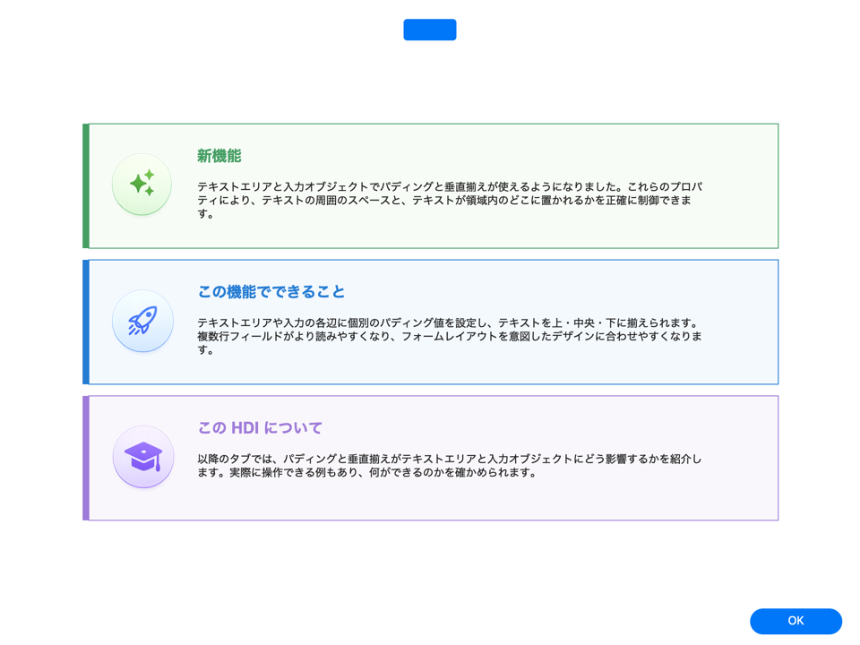
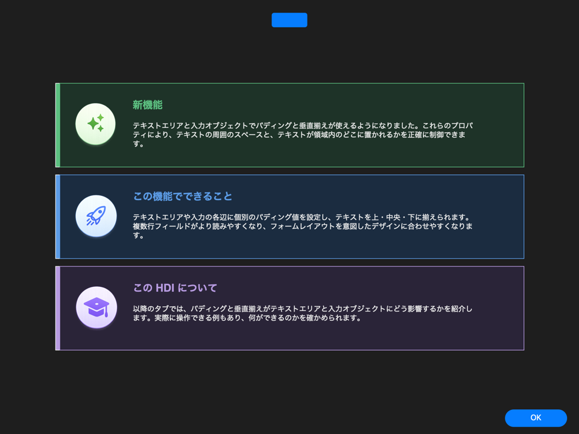
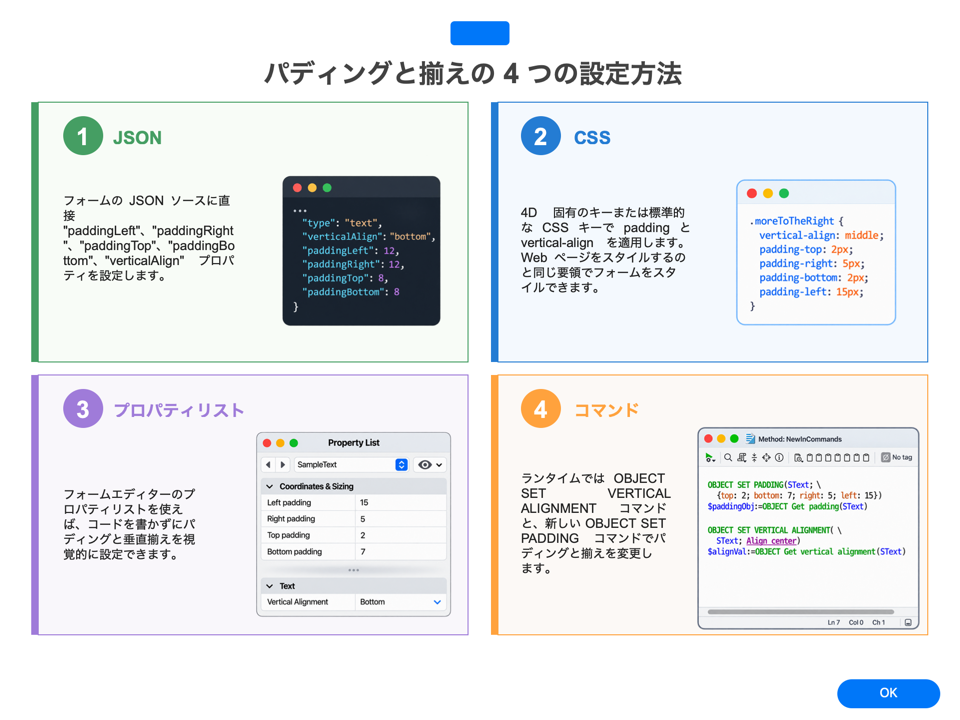
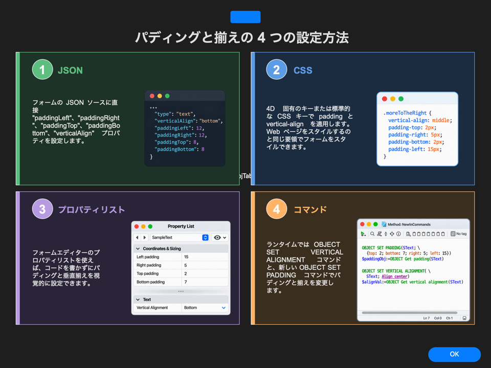
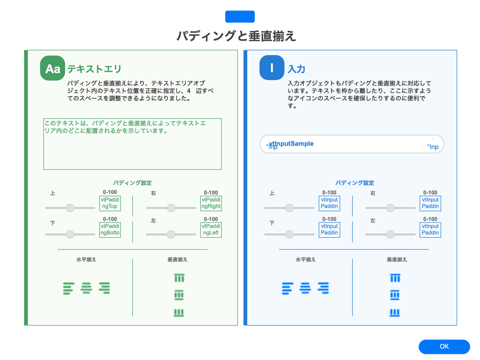
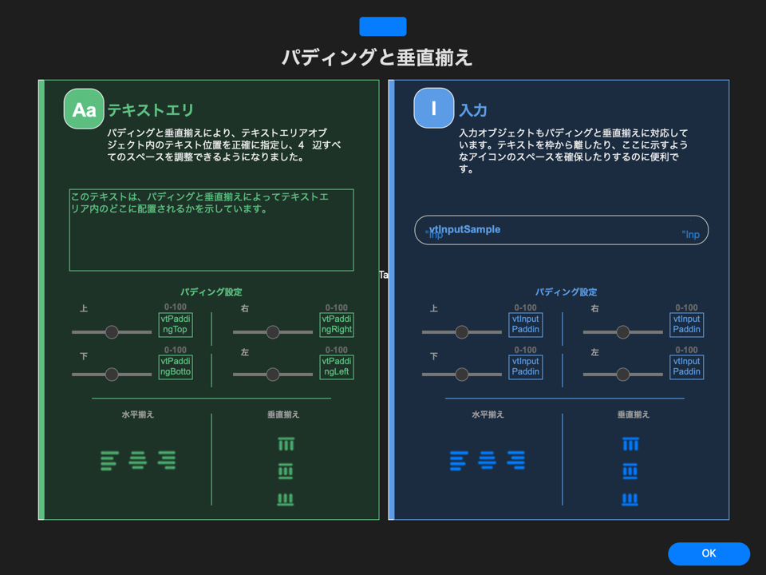

# HDI_FormObj_VericalAlignAndPadding

[日本語](#日本語) | [English](#english)

---

## 日本語

### このデモでわかること

テキストエリアと入力オブジェクトの**パディング**と**垂直揃え**を、4D 21 R5 のフォームオブジェクトプロパティで制御する方法を紹介する「How do I」デモです。サンプルデータはごく小さな INFO テーブル（3 レコード）だけで、ネットワーク接続・コンポーネント・モデルのダウンロードは一切不要です。

* 4 つの設定方法（JSON・CSS・プロパティリスト・コマンド）の比較
* `OBJECT SET PADDING` によるランタイムでのパディング変更（21 R5 の新コマンド）
* `OBJECT SET VERTICAL ALIGNMENT` / `OBJECT SET HORIZONTAL ALIGNMENT` による揃え変更
* 入力オブジェクト内のアイコン（検索・クリア）とパディングの関係
* `prefers-color-scheme` によるライト/ダーク両対応のスタイルシート
* macOS Tahoe の Liquid Glass テーマでの 27px ボタン高さ

### はじめかた

1. 4D 21 R5 以降でこのリポジトリをクローンし、`Project/HDI_FormObj_VericalAlignAndPadding.4DProject` を開きます。
2. デモフォームが直接開きます（スプラッシュは 21 R5 より古いバージョンで開いたときのバージョンゲートとしてのみ表示されます）。
3. UI の言語は OS の言語に従います（日本語 OS では日本語、それ以外では英語）。

### デモの進めかた

1. **情報** タブ: 機能の概要。
2. **設定方法** タブ: JSON・CSS・プロパティリスト・コマンドの 4 つの設定方法。
3. **試してみる** タブ: テキストエリアと入力のパディングをルーラーで操作し、垂直揃え（上・中央・下）と水平揃えを切り替えて比較します。

### しくみ

* `Sources/Methods/00_Start.4dm` — スタートアップ。ウィンドウの再利用（`WINDOW LIST` + `CALL FORM`）、`CALL WORKER(1; …)`、`SET MENU BAR(1)`、`DIALOG(…; *)` の標準パターン。
* `Sources/Methods/InitInfo.4dm` — タブタイトルを `Localized string("HDI2_Tab"+ページ番号)` で解決し、XLIFF に無い ID はデータの `TabTitle` にフォールバックします。
* `Sources/Forms/HDI2/ObjectMethods/*.4dm` — ルーラーとボタンが `OBJECT SET PADDING` 等を呼び出します。
* `Sources/styleSheets.css` — アクセントカラーとタイポグラフィ（ライト/ダーク）。`styleSheets_mac.css` / `styleSheets_windows.css` はテーマ別のコントロール高さだけを扱います。
* `Resources/ja.lproj/*.xlf` / `Resources/en.lproj/*.xlf` — UI 文字列。元データは `tools/xliff/strings.json` です。

### データを作り直すには

出荷時の `Data/` には INFO テーブルの 3 レコード（タブ番号とタイトル）のみが含まれ、言語依存のテキストはありません。タブタイトルは XLIFF から供給されるため、データを作り直す必要はありません。

---

## English

### What it demonstrates

A "How do I" demo showing how to control **padding** and **vertical alignment** on text areas and input objects with 4D 21 R5 form object properties. The sample data is a tiny INFO table (3 records); no network access, components or model downloads are needed.

* A side-by-side comparison of the four ways to set the properties (JSON, CSS, Property List, commands)
* Changing padding at runtime with `OBJECT SET PADDING` (new in 21 R5)
* Changing alignment with `OBJECT SET VERTICAL ALIGNMENT` / `OBJECT SET HORIZONTAL ALIGNMENT`
* Icons inside an input (search, clear) and how padding makes room for them
* Light/dark stylesheets driven by `prefers-color-scheme`
* 27px button heights under the macOS Tahoe Liquid Glass theme

### Key commands

| Command | Used for |
|---|---|
| [`OBJECT SET PADDING`](https://developer.4d.com/docs/commands/object-set-padding) | per-side padding at runtime (21 R5) |
| [`OBJECT SET VERTICAL ALIGNMENT`](https://developer.4d.com/docs/commands/object-set-vertical-alignment) | top/centre/bottom alignment |
| [`OBJECT SET HORIZONTAL ALIGNMENT`](https://developer.4d.com/docs/commands/object-set-horizontal-alignment) | left/centre/right alignment |
| [`Localized string`](https://developer.4d.com/docs/commands/localized-string) | localised strings in code (20 R7+) |
| [`SET DATABASE LOCALIZATION`](https://developer.4d.com/docs/commands/set-database-localization) | UI language follows the OS language |

### Requirements

* 4D 21 R5 or later (`compatibilityVersion` 2150)
* No network access, no components (`dependencies.json` is empty), no first-launch downloads

### Getting started

1. Clone this repository and open `Project/HDI_FormObj_VericalAlignAndPadding.4DProject` in 4D 21 R5 or later.
2. The demo form opens directly; the splash screen appears only as a version gate when opened with an older 4D release.
3. The UI language follows the OS language (Japanese on a Japanese system, English otherwise).

### Running the demo

1. **Info** tab: what the feature is.
2. **Setup Options** tab: the four ways to set padding and alignment.
3. **Try It!** tab: move the padding rulers on the text area and the input, then switch vertical and horizontal alignment to compare the results.

### How it works

* `Sources/Methods/00_Start.4dm` -- startup method using the standard pattern: window reuse (`WINDOW LIST` + `CALL FORM`), `CALL WORKER(1; …)`, `SET MENU BAR(1)`, `DIALOG(…; *)`.
* `Sources/Methods/InitInfo.4dm` -- resolves each tab title with `Localized string("HDI2_Tab"+page number)` and falls back to the stored `TabTitle` when the ID is not in the XLIFF files.
* `Sources/Forms/HDI2/ObjectMethods/*.4dm` -- the rulers and buttons call `OBJECT SET PADDING` and the alignment commands.
* `Sources/styleSheets.css` -- accent colours and typography (light and dark); `styleSheets_mac.css` / `styleSheets_windows.css` hold only theme-specific control heights.
* `Resources/ja.lproj/*.xlf` and `Resources/en.lproj/*.xlf` -- UI strings, generated from `tools/xliff/strings.json`.

### Points of interest

* `tools/xliff/strings.json` -- the single source for every localised string (68 IDs x 2 languages); regenerate the `.xlf` files from it.
* `Project/Sources/styleSheets.css` -- every custom colour has a dark-mode pair; the form JSON carries no visual properties for classed objects.

### Rebuilding the data

The shipped `Data/` contains only the 3 INFO records (tab number and title) and no language-dependent text: tab titles are supplied by the XLIFF files, so the data never needs rebuilding.

## References

* [Padding and vertical alignment -- fine-tune text placement in inputs and text areas (blog.4d.com)](https://blog.4d.com/padding-and-vertical-alignment-fine-tune-text-placement-in-inputs-and-text-areas/)
* [Style sheets](https://developer.4d.com/docs/FormEditor/stylesheets)
* [XLIFF translation files](https://developer.4d.com/docs/Translations/translating)

## Screenshots

Static reference renders of the demo form (Japanese UI):

| | Light | Dark |
|---|---|---|
| Info |  |  |
| Setup Options |  |  |
| Try It! |  |  |

## Modernisation notes

| Branch | Skill |
|---|---|
| [`modernise`](https://github.com/miyako/HDI_FormObj_VericalAlignAndPadding/tree/modernise) | [4dmodernise](.agents/skills/4dmodernise/SKILL.md), [4dstartup](.agents/skills/4dstartup/SKILL.md) |
| [`localise-ja`](https://github.com/miyako/HDI_FormObj_VericalAlignAndPadding/tree/localise-ja) | [4dlocalise](.agents/skills/4dlocalise/SKILL.md) |
| [`polish-ui`](https://github.com/miyako/HDI_FormObj_VericalAlignAndPadding/tree/polish-ui) | [polish-ui-pass](.agents/skills/polish-ui-pass/SKILL.md), [4dcss](.agents/skills/4dcss/SKILL.md) |
| [`demo-shareable`](https://github.com/miyako/HDI_FormObj_VericalAlignAndPadding/tree/demo-shareable) | [demo-shareable-repo](.agents/skills/demo-shareable-repo/SKILL.md) |
